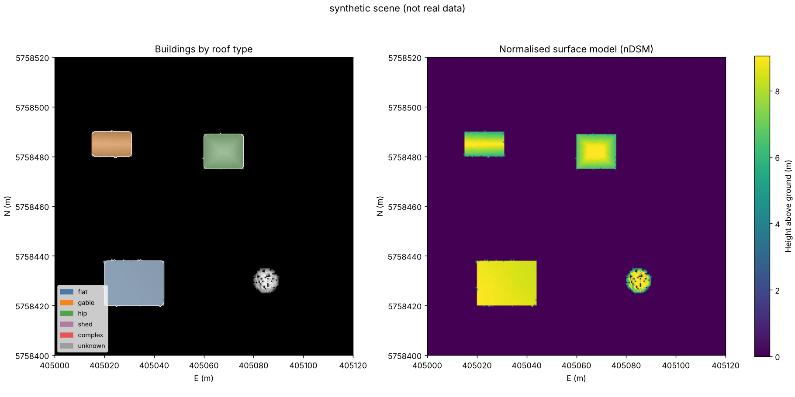
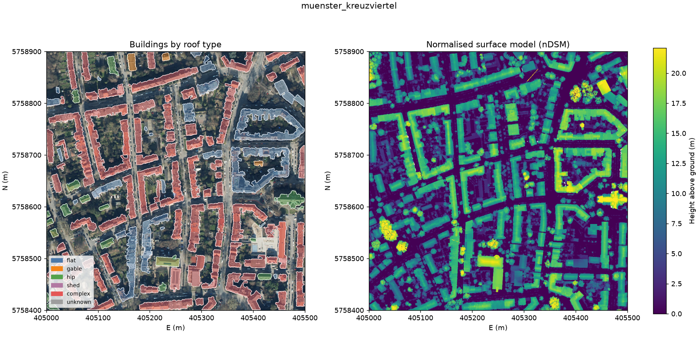

# nrw-roofs: building and roof analysis from open aerial LiDAR

A small, tested pipeline that takes **open airborne LiDAR and orthophotos from North Rhine-Westphalia (NRW, Germany)** and gives, for each building:

- footprint polygon (GeoJSON, CSV, GeoTIFF label raster)
- height above ground (max and median)
- roof planes with slope, aspect and true area (RANSAC + SVD refinement)
- roof type: flat, shed, gable, hip or complex
- roof area that is suitable for solar panels (flat, or pitched and facing east through south to west)

The default area is part of the Kreuzviertel in **Münster** (one 1 km NRW tile).


*The figure above is from the built-in **synthetic** scene (gable, hip and flat roof, plus one tree). It is not real data. See "Results" for the real Münster run.*

## Why

I built this weekend project to practise the full geospatial workflow for building analysis from aerial data: open data download, point cloud processing with PDAL, raster and vector work with GDAL, and geometric roof modelling. My daily work is 3D measurement and monitoring of bridges and other structures (drone photogrammetry, laser scanning, sensor data fusion). This repository shows the same methods on public data, with code that anyone can run.

## Pipeline

```
NRW open data (LAZ tile + DOP 10 cm JP2)
        │
        ▼
PDAL: crop → outlier filter → SMRF ground → height above ground → DSM / DTM GeoTIFF
        │            (fallback without PDAL: laspy + morphological ground filter)
        ▼
Rasters: DSM, DTM, nDSM (0.5 m), single-return ratio
        │
        ▼
Building mask: nDSM > 2.5 m  AND  mostly single returns (removes trees)
        │   → morphological clean-up → polygons (GDAL/rasterio) → min. area 30 m²
        ▼
Per building: roof points → sequential RANSAC planes → slope, aspect, area
        │   → roof type, PV-suitable area
        ▼
Outputs: buildings.geojson (WGS84), buildings.csv, dsm/dtm/ndsm/buildings.tif,
         overview.png, summary.md, optional orthophoto chips per building
```

## Data

| Data | Source | Format |
|---|---|---|
| Airborne LiDAR (3D-Messdaten) | Geobasis NRW, `opengeodata.nrw.de/produkte/geobasis/hm/3dm_l_las/` | LAZ, 1 km tiles, EPSG:25832 |
| Digital orthophotos (DOP10) | Geobasis NRW, `opengeodata.nrw.de/produkte/geobasis/lusat/akt/dop/dop_jp2_f10/` | JP2, 10 cm, RGBI |

Licence of the data: **Datenlizenz Deutschland – Zero – Version 2.0** (free use, no attribution required; attribution "© Geobasis NRW" is given here anyway). The data is not in this repository. The `download` command gets it.

## Install

With PDAL (recommended):

```bash
conda env create -f environment.yml
conda activate nrw-roofs
pip install -e .
```

Without PDAL (pure pip; the pipeline then uses the laspy fallback):

```bash
pip install -e ".[test]"
```

## Run

```bash
nrw-roofs download config/muenster_kreuzviertel.yaml      # ~ 300–500 MB per tile
nrw-roofs run config/muenster_kreuzviertel.yaml --chips
```

Options for `run`: `--fallback` (do not use PDAL), `--chips` (save one orthophoto image per building, for example as input for a later image model), `--lidar` / `--ortho` (use your own files).

To use another area, copy the config and change `tile` and `aoi` (EPSG:25832 metres, inside the tile).

## Tests

```bash
pytest
```

The tests do not need a network connection or PDAL. A synthetic LAZ tile with known geometry checks:

- the tree is not detected as a building
- footprint areas are within 15 % of the true values
- gable roof: two planes, slope 35° ± 2°, aspects 0° and 180°
- hip roof: four planes; flat roof: one plane
- solar area: the south-facing half of the gable roof, the full flat roof
- the PDAL pipeline definition, the NRW file listing parser and the config validation

## Results

Real run on 0.25 km² of the Kreuzviertel in Münster (NRW tile `32_405_5758`, DOP 2026), with PDAL ground classification:



| | |
|---|---|
| Points processed | 2,535,598 |
| Buildings found | 116 |
| Total footprint | 76,493 m² |
| PV-suitable roof area | 39,467 m² |
| Run time (laptop, Windows) | 90 s |

| Roof type | Buildings |
|---|---|
| complex | 72 |
| flat | 23 |
| hip | 18 |
| gable | 3 |

**How to read this result**

- Footprints follow the buildings well, and street trees and courtyard trees are not detected as buildings (single-return filter).
- Most buildings are "complex" because the Kreuzviertel has closed perimeter blocks: houses that touch each other become one polygon, and one polygon then holds many gable planes in different directions. The roof planes themselves are found; the label is per polygon, not per house.
- The fix is to split the polygons with the official ALKIS building outlines, or to report results per roof plane. This is the first item in "Next steps".
- With the laspy fallback ground filter (no PDAL) the same tile gives 128 buildings. The difference comes from PDAL's outlier filter and SMRF, which give a cleaner ground model.

## Known limits

- Building detection uses height and return count only. Large dense trees that give single returns, and very low buildings (< 2.5 m), can be wrong.
- Roof plane area is estimated from the share of points × footprint area / cos(slope). This is correct for even point density.
- Dormers and small roof parts below 5 % of the roof are not used for the roof type.
- No shading analysis for the solar area yet.

## Next steps

- Split merged perimeter blocks with the official NRW building outlines (ALKIS), and compare footprints with them (IoU).
- Report and map results per roof plane (slope, aspect, area), not only per building.
- Use the orthophoto chips to train a small image model for roof elements (dormers, windows, existing solar panels), and fuse it with the LiDAR planes.
- Export LoD2-style roof geometry (CityJSON).

## Licence

Code: MIT. Data: © Geobasis NRW, Datenlizenz Deutschland – Zero – Version 2.0.
